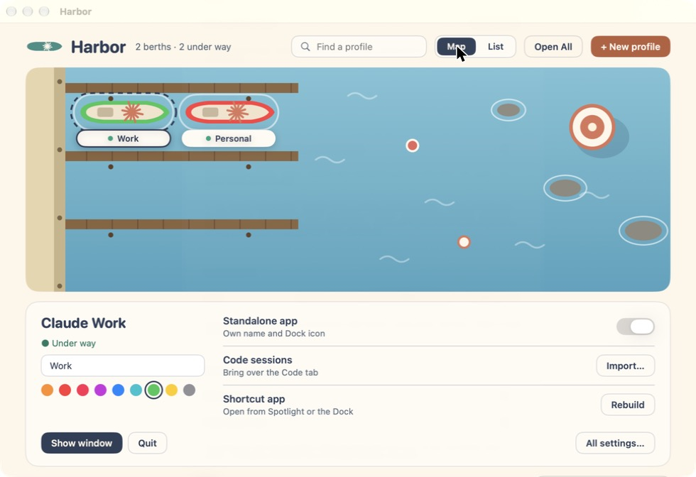
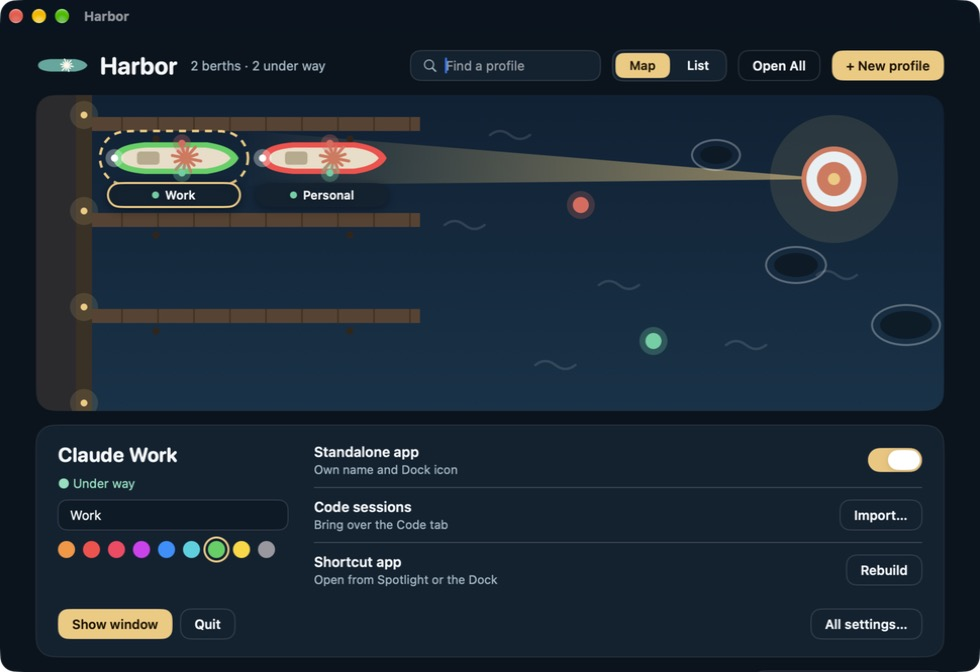
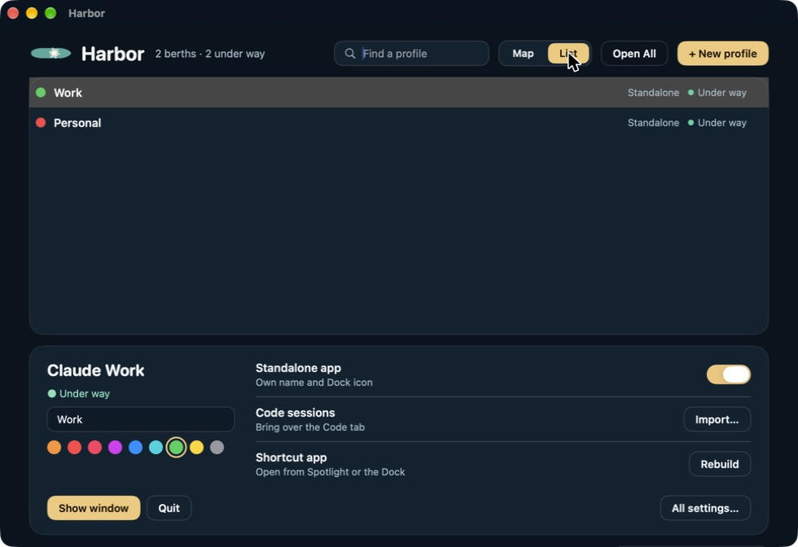
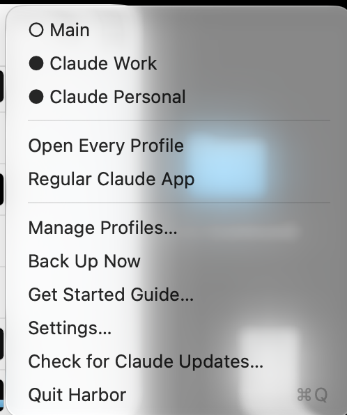

# Harbor

A harbor is where many boats dock side by side, each tied up at its own berth,
safe and separate, but sharing the same stretch of water. That's the idea behind
the name: every Claude account you add is its own boat, moored in Harbor's map,
coming and going independently without ever getting in each other's way.

Use several Claude accounts on this Mac at the same time. Each profile is its own
Claude Desktop window with its own sign-in and chat history — no logging in and out,
no profile folders to manage by hand.

## Why

Claude Desktop only supports one signed-in account at a time. If you use Claude for
both work and personal accounts — or run a few side projects under different
organizations — switching back and forth means signing out and back in every time.
Harbor runs each account in its own window, side by side, so none of that is
necessary.

## Download

Grab the latest `.dmg` from the [Releases page](../../releases/latest). It's a
universal app (Apple silicon and Intel) for macOS 14 or later.

## Getting started

1. Open Harbor and click **+ New profile**. Give it a name (e.g. "Work") and a color.
2. Click the profile, then **Show window** (or double-click it on the map). Sign in
   to that Claude account — Harbor remembers it from then on.
3. Repeat for each account. Harbor shows a short walkthrough the first time it
   opens, and you can bring it back later from Settings → Help.

## Features
- Create, rename, recolor, reorder and delete profiles (one per Claude account)
- Open a profile, or every profile at once, from the window or the menu bar icon
- "Create App" makes `Claude <Name>.app` in `~/Applications/Harbor Profiles`
  with a color-badged icon, for Spotlight / Launchpad / the Dock
- Pick your own icon for each profile's shortcut (any PNG, JPEG, HEIC or .icns image),
  with the color badge on or off
- "Open Claude Code" runs `claude` in Terminal with that profile's own `CLAUDE_CONFIG_DIR`
- Optional: send `claude://` links (browser sign-in, magic links, shared chats) to the
  profile you were last using, or ask which profile if it can't tell

- Optional per profile: **Standalone app** makes a full copy of Claude (`Claude <Name>.app`, own bundle ID,
  name and icon) so each profile gets its own Dock icon. It opens that profile's account even when Harbor
  isn't running, and is rebuilt automatically when Claude updates.

- "Import…" copies the Code tab's chat list from the regular Claude app into a profile (preview first, undoable).
  Permissions, connector settings and cached prompts are removed from each copy; nothing in the regular app changes.

## How it works
Claude Desktop is started with `--user-data-dir=<profile folder>`. Profile data lives in
`~/Library/Application Support/Harbor/Profiles/<id>/Data`. The Claude app itself
is never copied or modified, so it keeps updating itself normally.

## Build
Needs the Xcode Command Line Tools (full Xcode not required):

    ./build.sh

The app is written to `build/Harbor.app` (universal, ad-hoc signed).

## Limits
- Every profile's window uses Claude's normal Dock icon (the shortcut apps carry the colored badge).

## Standalone apps: trade-offs
- Keychain: copies are signed with "Harbor Local Signing" (Harbor's own keychain, nothing added to system trust).
  macOS asks for "Claude Safe Storage" once per standalone app, and again only if the certificate is reset
  (Settings > Advanced) or signing falls back to ad-hoc.
- Disk: copies are APFS clones (nearly free). On non-APFS volumes each copy is Claude's full size.
- Managed installs: Harbor warns before copying a Claude that has MDM managed preferences.
- The copy's own updater may report errors; that's harmless, Harbor rebuilds from the updated Claude.app.

## Sharing
    ./package.sh

Builds the app and writes `dist/Harbor-<version>.dmg`, a `.zip` and a `.sha256` file. The app is
universal (Apple silicon and Intel), needs macOS 14 or later, and is ad-hoc signed, not signed with an
Apple Developer ID or notarized. Anyone who receives it must approve it once the first time it opens
(right-click Open, or System Settings > Privacy & Security > Open Anyway). The disk image includes a
"Read me first.txt" that explains this. Signing with a Developer ID and notarizing it would remove
that step.
